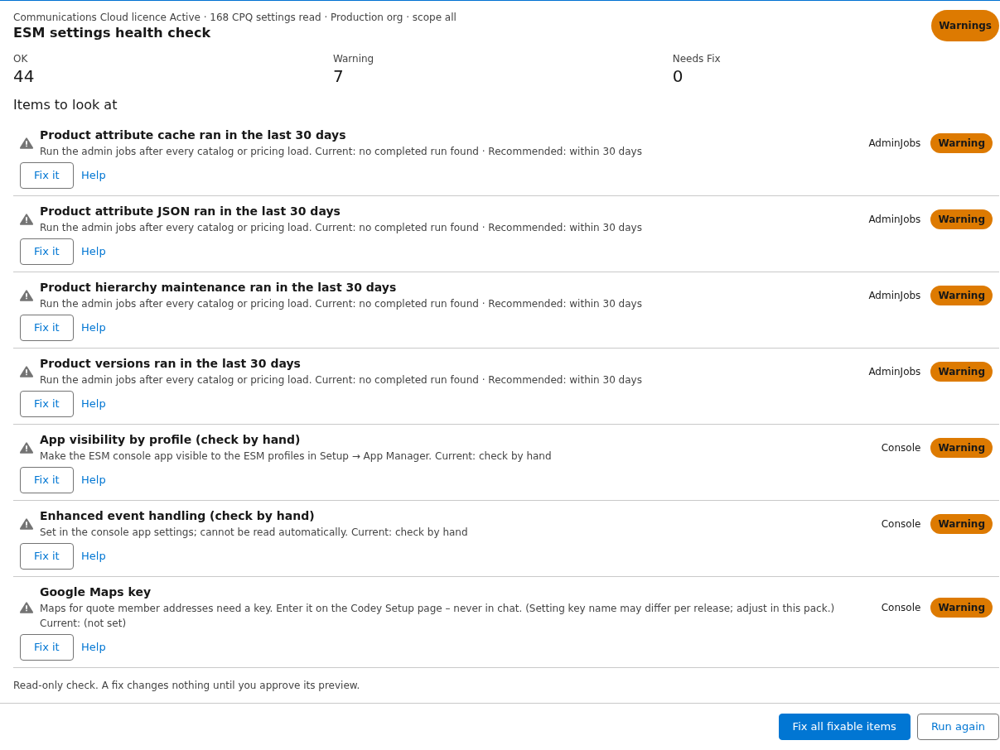
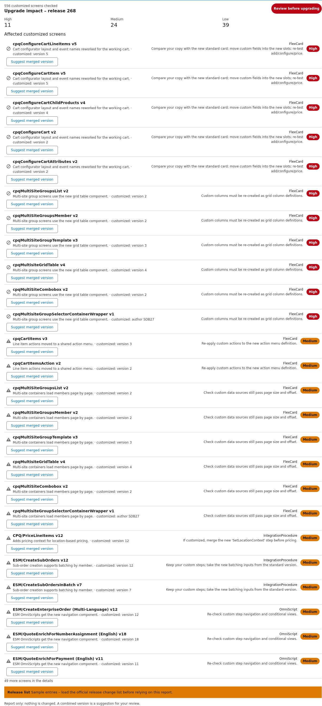
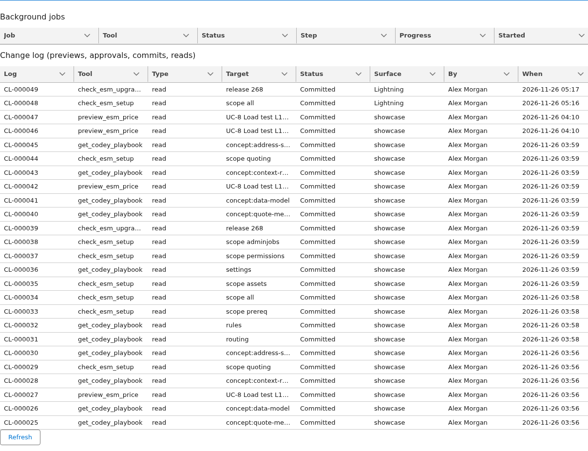
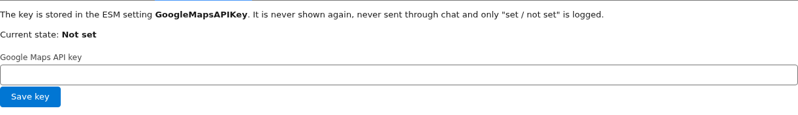
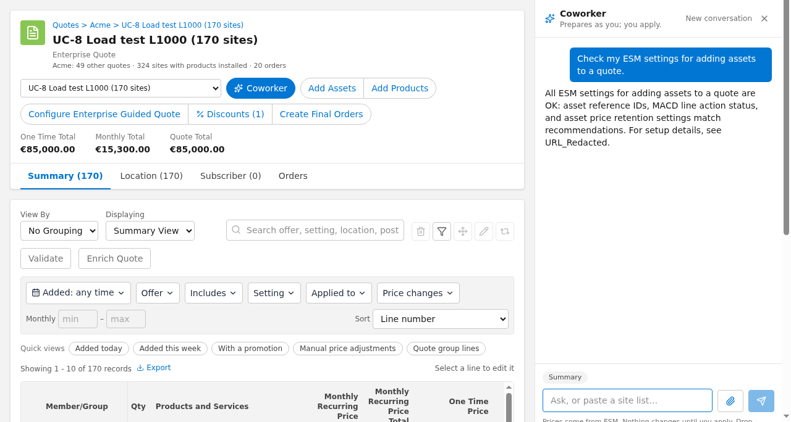
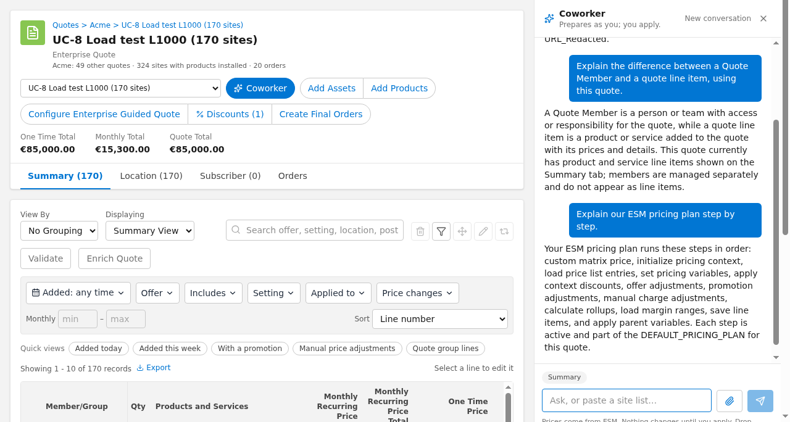
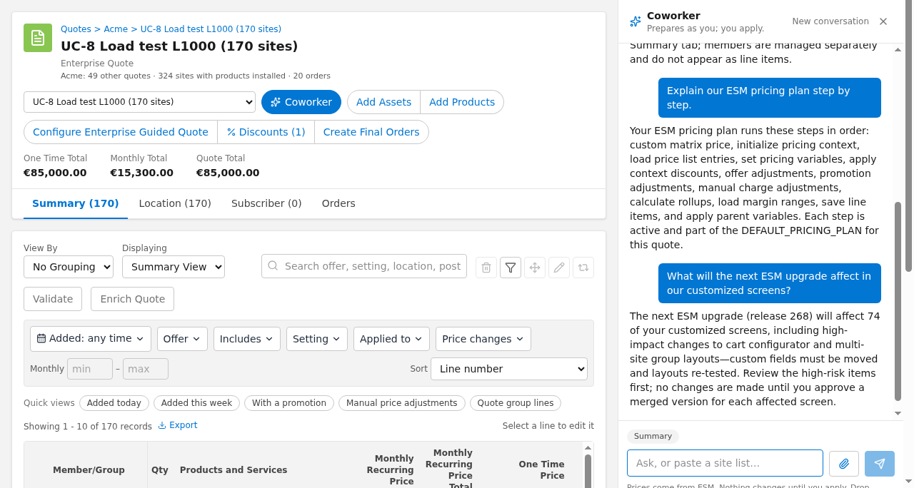
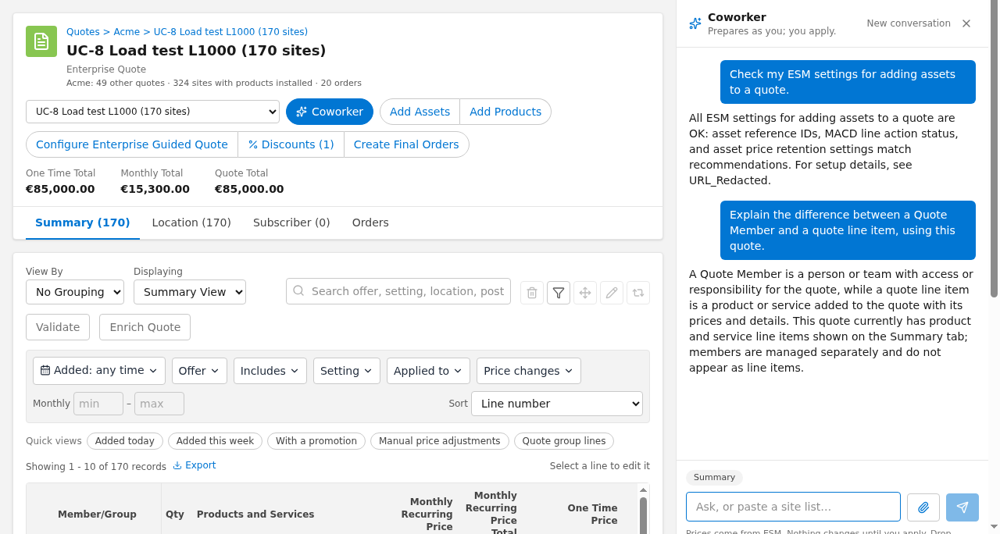
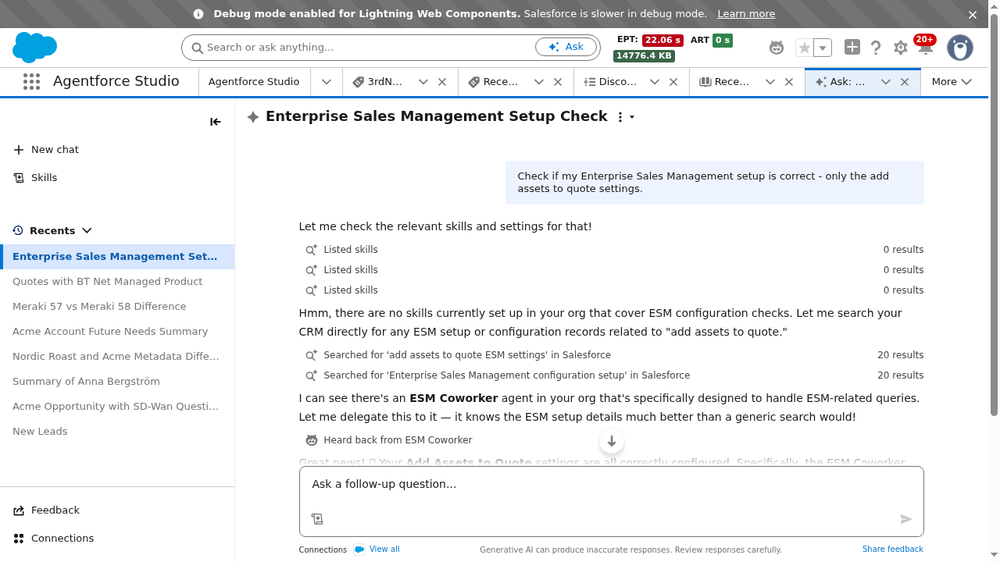
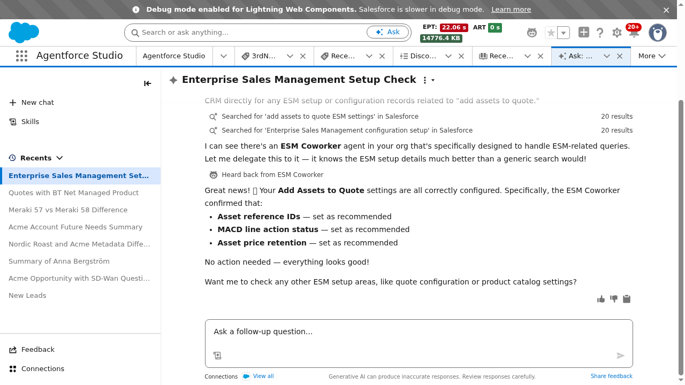

# Project Codey – what it looks like (real screens from esm264)

Captured on 26 Nov 2026 in the reference org **esm264** using **read-only requests only**: no previews, no approvals, no jobs,
no changes to ESM settings, quotes or permissions. Each request added one usage line to the Codey Change Log.

| # | Screen | Where | Skill |
|---|---|---|---|
| 1 | Health check report | Codey Setup app | Settings health check |
| 2 | Upgrade impact report | Codey Setup app | Upgrade check |
| 3 | Activity – Change Log and jobs | Codey Setup app | (audit / usage tracking) |
| 4 | Secure Google Maps key form | Codey Setup app | Fresh install |
| 5 | Coworker – settings check | ESM New Experience + Coworker, on a quote | Settings health check |
| 6 | Coworker – price plan explained | same | Pricing |
| 7 | Coworker – upgrade check | same | Upgrade check |
| 8 | Coworker – concept question (finding) | same | Concepts guide |
| 9 | Agentforce Coworker (Lightning header → **Ask**) – the question and its route | `/lightning/coworker` | Settings health check |
| 10 | Agentforce Coworker – the answer | same | Settings health check |

---

## 1. Health check report (Codey Setup app → Health check → Run health check)
What it shows: every recommended setting compared with the org – 44 OK, 7 Warning, 0 Needs Fix – each with the reason, the current
and recommended value, **Fix it** (starts a preview that must be approved) and **Help** (the Salesforce help article).

## 2. Upgrade impact report (Codey Setup app → Upgrade impact → Check upgrade impact)
What it shows: the customized ESM screens and procedures that release 268 affects – 11 High, 24 Medium, 39 Low – with what changed,
why it counts as customized (version, author), the suggested action, and **Suggest merged version** (a suggestion for review, never
deployed automatically). The orange bar is a reminder that the release list is still a sample.

## 3. Activity – what Codey did (Codey Setup app → Activity)
What it shows: background jobs (none have run here) and the Codey Change Log – every read, preview, approval and change, with the
tool, target, status, surface (Lightning, Coworker, Agentforce, showcase…), who and when.

## 4. Secure Google Maps key (Codey Setup app → Google Maps key)
What it shows: the only place a key is entered – a masked field; the key is never shown again, never sent through chat, and only
"set / not set" is logged. Current state in esm264: **Not set** (one of the 7 warnings).

## 5. ESM Coworker – "Check my ESM settings for adding assets to a quote."
Opened on the Enterprise Quote "UC-8 Load test L1000 (170 sites)". The Coworker sent the request to the **Codey build helper**,
which ran the settings check for the add-assets area: *"All ESM settings for adding assets to a quote are OK…"*.
(The help link is masked as "URL_Redacted" by the org's AI trust layer.)

## 6. ESM Coworker – "Explain our ESM pricing plan step by step."
Answered by Codey from the org's real pricing plan: the 12 steps of DEFAULT_PRICING_PLAN in order.

## 7. ESM Coworker – "What will the next ESM upgrade affect in our customized screens?"
Answered by Codey's upgrade check: release 268 affects 74 customized screens, high-impact items first; nothing is changed until a
merged version is approved.

## 8. ESM Coworker – concept question: a finding to fix
Question: *"Explain the difference between a Quote Member and a quote line item, using this quote."*
The Coworker **did not** pass this question to the Codey build helper (no Codey call in the Change Log); its existing *explain*
helper answered on its own and the answer is **wrong** – a Quote Member is a site/location on the quote, not "a person or team".
The same question asked to the **ESM Codey** agent and to the Codey tools returns the correct answer with this org's numbers
(see `docs/showcase/esm264-showcase.md`, step 10).
**Fix (not applied – it changes the Coworker):** in the Coworker router, send "how does / explain / difference between" questions
about ESM concepts to the Codey build helper before the existing explain rule (new Coworker version; v33 stays for rollback).

## 9. Agentforce Coworker (Lightning header → Ask) – "Check if my Enterprise Sales Management setup is correct – only the add assets to quote settings."
The Salesforce Coworker opened from **Ask** in the Lightning header. It first looked for a matching **skill** ("Listed skills – 0
results": no Coworker skills exist in this org yet), searched Salesforce, then **delegated to the ESM Coworker agent**, whose Codey
build helper ran the settings check (Change Log: `check_esm_setup · scope assets · Coworker`).

## 10. Agentforce Coworker – the answer
"Your Add Assets to Quote settings are all correctly configured… Asset reference IDs, MACD line action status, Asset price retention
— set as recommended. No action needed."

### Making the Codey skills first-class Coworker skills (not done yet – it adds records)
Agentforce Coworker has a **Skills** library (Agentforce Studio → Skills → New). A Coworker skill has exactly the parts of a Codey skill:

| Coworker skill field | Filled from the Codey skill |
|---|---|
| Skill name | e.g. "ESM settings health check" |
| Description ("so your agent can find and use it") | the `description` line of `skills/<name>/SKILL.md` |
| Target agent | **ESM Codey** (or Any Agent) |
| API name | `esm_settings_health_check` … |
| Instructions (with **@** resources) | the steps of the SKILL.md, with the Codey actions inserted as resources (`@check_esm_setup`, `@apply_esm_change`, …) |

With the 8 skills added, Coworker would pick the Codey skill directly ("Listed skills → 1 result") instead of searching and
delegating, and the same skills would appear in **Browse** for every user. This is 8 new AI Skill records, so it needs your go-ahead.

---

## About the HXL widgets
The four experience cards (Approval, Health check report, Progress tracker, Upgrade impact report) are deployed as HXL widgets
(UiWidgetBundles + Lightning Types), and every Codey tool returns the card data. **The screens above show that card data rendered by
the Codey Setup app (Lightning)** and the Coworker's answers as text. In this org the Agentforce and Coworker conversations show
text answers; showing the HXL widgets inside the conversation needs the tools' card output to be bound to the Codey Lightning Types
for that surface – this was not set up yet, so there is no screenshot of a widget inside a chat. Text versions of all four cards
(as Slack, Teams or any chat would show them) are in `hxl/samples/` and in the showcase report.

The **Approval** card and the **Progress tracker** only appear when a change is previewed or a job is started, so they were not
produced in this read-only session.
